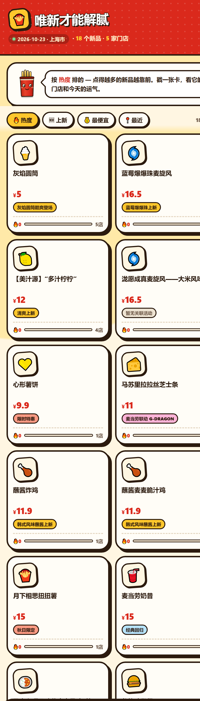

# 唯新才能解腻 🍟

> 麦当劳新品货架 —— 把「今天有什么新品、在哪家店、多少钱、有什么连带活动」做成一张点开就能逛的卡通货架。
>
> **非麦当劳官方产品**，基于麦当劳开放 MCP 能力独立开发，为「1024 程序员节 · 麦当劳程序员创意开发大赛（M-CODE）」参赛作品。



## 这是什么

「上新」信息散落在 App 的各个角落：菜单里的一个小角标、活动日历里的一行字、不同城市的门店还各有差异。本项目用 MCP 把它们拧成一件事：

**首页罗列全部新品 → 点开看详情（门店 / 价格 / 祝福签）→ 选一家店直接生成下单凭证。**

### 功能

| 功能 | 说明 |
|---|---|
| 新品货架 | 首页 2 列卡片网格，展示当日候选池全部食品类新品（周边商品自动剔除） |
| 热度排序 | 点开详情即计入热度，按「点的人多」重排，附上新时间 / 价格 / 距离排序 |
| 详情弹层 | 吉祥物送出一句祝福签 + 商品介绍 + 官方连带活动卡（联名 / 限时 / 回归） |
| 门店列表 | 每个新品列出附近 5 家门店的在售状态、步行距离、实测价格 |
| 下单凭证 | 选门店 + 数量，生成可直接执行的 `create-order` 指令，一键复制即真实下单 |
| 离线演示 | 内置真实抓取数据，无需 Token 也能完整体验 |

### 一个真实的发现

「上新」并不是全国一致的：实测上海 / 成都 / 广州三家门店，约七成新品全国同步，约三成存在区域差异——成都独有三文鱼双虾至尊月堡，上海独有奶昔回归。**你看到的货架就是你那家店的新品组合**，这正是这个工具存在的理由。

## 安装与运行

零依赖，纯静态页面 + Python 标准库脚本。

```bash
# 1. 体验（离线模式，无需任何配置）
#    直接用浏览器打开 index.html 即可

# 2. 抓取你自己的门店数据（需要麦当劳 MCP Token）
export MCD_MCP_TOKEN=你的Token        # 也可配置在 ~/.workbuddy/mcp.json

python fetch_pool.py   --city 上海市 --keyword 人民广场   # 抓候选池
python fetch_matrix.py --city 上海市 --keyword 人民广场 --limit 5   # 抓多门店矩阵
python build_site.py                                            # 合并生成 data/items.js
# 刷新 index.html，货架即为你门店的数据
```

> ⚠️ 本仓库不含任何 Token / 密钥。Token 只从环境变量 `MCD_MCP_TOKEN` 或本地 `~/.workbuddy/mcp.json` 读取。

### 使用示例

```text
打开 index.html
→ 首页看到 18 个新品卡片（按热度排序，NO.1 挂徽章）
→ 点「蓝莓爆爆珠麦旋风」→ 弹出详情：¥16.5、官方活动卡、祝福签「爆珠一响，好事成双」
→ 门店列表按距离排列，点 144 米外的华旭店「下单」
→ 选数量 2，确认，复制下单凭证 → 交给支持麦当劳 MCP 的 AI 助手执行即完成下单
```

## 目标用户

- **尝鲜族**：想第一时间吃到新品，但不想每天翻 App 找角标的人
- **选择困难户**：新品太多不知道挑哪个，需要价格 / 距离 / 活动一起看
- **麦门考据党**：关心「我这家店有没有」「和别家差在哪」的区域差异观察者

## 项目结构

```text
index.html            # 单文件 H5（零依赖，内嵌离线兜底数据）
fetch_pool.py         # 抓单个门店候选池（query-meals → calculate-price）
fetch_matrix.py       # 抓多门店新品矩阵（5 家店交叉比对）
build_site.py         # 合并候选池 + 门店矩阵 + 文案资产 → data/items.js
data/copy.json        # 人工维护的祝福签 / 介绍文案资产（按名称归一化匹配）
out/                  # 界面截图
```

## 已知边界（诚实声明）

- **下单凭证不是支付链接**：`create-order` 是服务端能力，静态网页不能存放用户 Token。凭证 + MCP AI 助手 = 真实下单；接后端代理后可直接返回官方支付链接。
- **热度目前是本机计数**：跨用户热度榜需要云端计数服务，数据结构已预留。
- **时段影响**：正餐新品在早餐时段不上架（实测 8:50 仅 4/18 在售），页面会对未经当餐时段实测的门店标注「时段校验」。
- 营养数据：官方营养接口为静态清单，不覆盖当期新品，故本项目不提供卡路里维度，避免编造数据。

## 许可与声明

参赛声明见 [CONTEST_DECLARATION.md](./CONTEST_DECLARATION.md)（官方原文）。本项目为娱乐性与工具性推荐，无兑奖机制，与麦当劳官方积分抽奖无关；餐品、价格与供应状态以麦当劳官方渠道实时结果为准。
